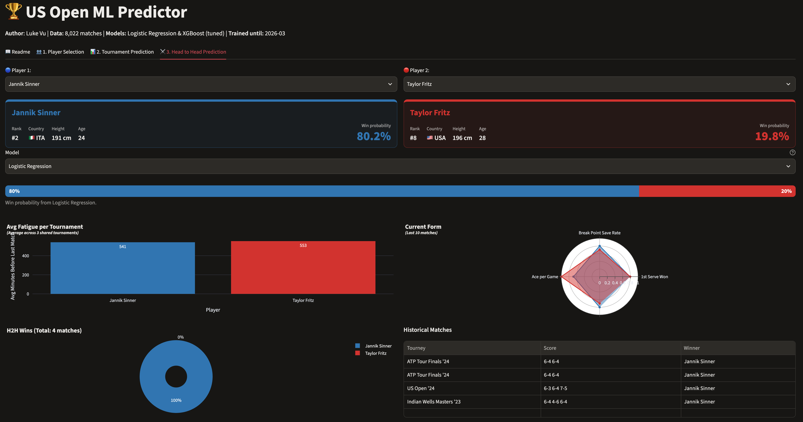
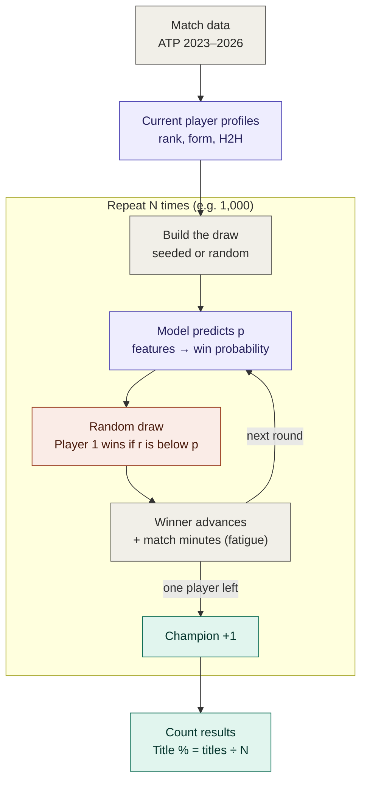

# 🏆 US Open 2026 ML Predictor


Predicts the probability that one tennis player beats another, then simulates the full US Open draw thousands of times to estimate each player's title chances.



## 1. Approach

### Match model
Each match is one row comparing the two players. Features are the **difference** between Player 1 and Player 2, using only information available **before** the match:
* **Ranking:** log ATP rank and ranking points
* **Recent form (last 10 matches):** 1st serve in %, 1st-serve points won, break points saved, aces per service game, win rate
* **Fatigue:** minutes already played in the current tournament
* **Head-to-head:** previous meetings and H2H win rate
* **Physical:** height

### Tournament simulator (Monte Carlo)
The model predicts **one match**, but a title requires winning five matches in a row, against opponents that depend on earlier results and with fatigue that depends on each player's path. There's no simple formula for that, so the app **plays out the whole bracket many times and counts**.

One simulated tournament:
1. **Draw:** seeded bracket (1 vs 32, 16 vs 17, …) like the real event, or reshuffled every run.
2. **Each match:** the model gives P(Player 1 wins) = p. A random number r between 0 and 1 is drawn; Player 1 wins if r < p. So a p = 0.70 favorite wins about 70% of the time, and upsets happen at a realistic rate.
3. **Fatigue:** each match length is sampled from real Grand Slam matches and added to both players' minutes, which the model uses in later rounds.
4. **Repeat** each round until one champion remains.

Repeated N times (up to 5,000), a player's **title probability = titles ÷ N**. With 1,000 runs, a 20% estimate is accurate to about ±1.3 percentage points.

**Why random, not "the favorite always advances"?** The model's probabilities are calibrated (70% predictions win about 70% of the time), and about one-third of real test matches were won by the lower-rated player. Always advancing the favorite would produce zero upsets and give the top seed a 100% title chance. Sampling from p reproduces the real upset rate.

**Speed:** all N tournaments are simulated in parallel. Each round is a single batched model call, so 1,000 tournaments run in well under a second.


*Purple = deterministic (features and model) · Coral = the only random step · Green = results*
## 2. Results

Trained on ATP matches 2023–2025, tested on the following ~1,000 matches (time-based split, both players ranked in the top 100):

| Model | Accuracy | Log loss ↓ | ROC-AUC |
|---|---|---|---|
| Coin flip | 47.8% | 0.693 | 0.500 |
| Rank only (baseline) | **67.3%** | 0.607 | 0.733 |
| Logistic Regression | 67.1% | **0.606** | 0.731 |
| XGBoost (default) | 62.0% | 0.711 | 0.678 |
| XGBoost (tuned) | 66.2% | **0.606** | 0.732 |

**Key finding:** ranking alone already captures most of the predictable signal. Tuning improved XGBoost a lot (0.711 → 0.606), but it only tied logistic regression and the rank-only baseline. Form, fatigue and H2H add little, because ranking itself summarizes recent results. Both models are well calibrated, so their probabilities are safe to use in the simulation, and the app lets you choose either.

## 3. Key Design Decisions
* **Clean before reshaping:** filtering after splitting matches into winner/loser rows had created an artificial 67/33 class imbalance.
* **One row per match, random P1/P2:** balanced classes (49/51) with no class weighting, which would distort probabilities.
* **No data leakage:** every feature uses only earlier matches (`shift(1)`), and the train/test split and cross-validation are time-ordered (`TimeSeriesSplit`).
* **Evaluated on probabilities:** log loss, Brier score and a calibration curve, not just accuracy, because the simulation uses the probabilities directly.
* **Shared feature code:** `features.py` is imported by both the notebook and the app, with a test asserting it reproduces the training data exactly (no train/serve skew).

## 4. Application Features
* **👥 Player Selection:** choose up to 32 players; seeds come from `Players.csv`.
* **📊 Tournament Prediction:** seeded bracket or random draw, title and final probabilities for every player, choice of model.
* **⚔️ Head to Head:** win probability for any two players, with their current form, fatigue history and past meetings.

## 5. Repository Structure
```
├── app.py               # Streamlit app (simulation and UI)
├── features.py          # Shared cleaning and feature engineering
├── US_Open_26.ipynb     # EDA, model training and evaluation
├── requirements.txt     # Python dependencies
├── models/
│   └── match_model.pkl  # Both trained models + feature list + test metrics
└── data/
    ├── 2023.csv … 2026.csv  # ATP match results by year
    └── Players.csv          # Seeded players for the tournament
```

## 6. Installation & Usage
```bash
git clone https://github.com/Lukevu-hub/us-open-ml-predictor.git
cd us-open-ml-predictor
python3 -m venv venv
source venv/bin/activate
python3 -m pip install -r requirements.txt
streamlit run app.py
```
To retrain the models, run `US_Open_26.ipynb` from top to bottom.

## 7. Limitations & Next Steps
* Surface isn't modeled. The US Open is on hard courts, so surface-specific Elo ratings are a natural next feature.
* About 4 seasons of data; players with few matches have noisy form and H2H values.
* Injuries, withdrawals and time off between tournaments aren't modeled.

**Author:** Luke Vu